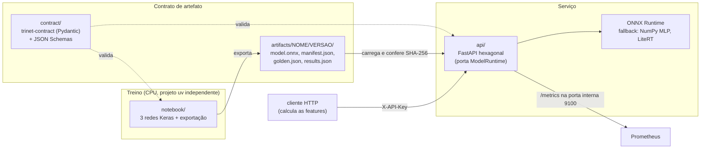

# TriNet

TriNet ("três redes") é um projeto educacional de aprendizado profundo aplicado a **risco financeiro**. Reúne duas
entregas ligadas por um contrato de artefato:

1. **Notebook (entrega da disciplina CIC407, T2, Aprendizado Profundo).** Três redes construídas camada a camada com
   `tf.keras.layers`, treinadas em CPU: risco de crédito (inadimplência de cartão, MLP), risco de mercado "por
   números" (volatilidade futura de ações do S&P 500, MLP) e risco de mercado "por imagem" (regime de volatilidade a
   partir de gráficos OHLC renderizados, CNN). Cada modelo é exportado como `model.onnx` + `manifest.json` + golden
   samples.
2. **API de inferência de produção.** FastAPI com arquitetura hexagonal enxuta, dirigida pelo manifesto de cada modelo.
   Serve os três modelos com ONNX Runtime (sem TensorFlow na imagem), testa o *training-serving skew* com golden
   samples e vem com observabilidade, contêiner endurecido e CI/CD com gates de segurança e atestação da cadeia de
   suprimentos.

> **Aviso: uso educacional.** Este é um trabalho de curso. **Nada aqui é recomendação de investimento**, e o modelo de
> crédito **não é** um modelo de decisão de crédito real: os dados são de Taiwan, 2005, e o limiar de decisão usa
> custos ilustrativos. Não use as saídas da API para conceder ou negar crédito, nem para comprar ou vender ativos.
> Os vieses dos dados estão em [Limitações](#limitações) e em cada [model card](docs/model-cards/README.md).

A especificação completa (decisões, riscos, cronograma) está em [`PLANO.md`](PLANO.md); a seção "v1.2" dele define o
foco em mercado financeiro. As decisões arquiteturais estão em [`docs/adr/`](docs/adr/README.md).

> **Estado atual.** Os artefatos versionados em `artifacts/<modelo>/1.0.0/` são os **modelos reais**, treinados pelo
> notebook em CPU e exportados com o quality gate aprovado. Todos têm status `candidate`: nenhum foi promovido a
> `release` nem publicado como imagem `latest`. Os ganhos sobre os baselines são **modestos** e vêm com limitações
> importantes (viés de sobrevivência, regime único, fonte de preços não auditada). Veja
> [Resultados dos modelos](#resultados-dos-modelos) e [Limitações](#limitações).

| Modelo | Problema | Dados | Entrada da API | Saída |
|---|---|---|---|---|
| `credit-default-mlp` | risco de crédito: classificação binária desbalanceada | *Default of Credit Card Clients* (UCI #350) | JSON com 21 campos crus do cliente | `no_default` ou `default`, com probabilidades |
| `volatility-mlp` | risco de mercado: regressão | S&P 500, 5 anos (Kaggle) | JSON com 20 features **já calculadas** pelo chamador | volatilidade realizada dos próximos 5 pregões, anualizada (fração) |
| `candlestick-cnn` | risco de mercado "visual": classificação de imagens em 3 classes | gráficos OHLC + volume renderizados das mesmas ações | PNG 64x64x3 (só PNG) | regime `baixa`, `media` ou `alta` |

As redes 2 e 3 modelam a **mesma grandeza** (volatilidade dos próximos 5 pregões) por duas vias, números e imagem,
para responder: o gráfico acrescenta algo além das features numéricas?

## Sumário

- [Arquitetura](#arquitetura)
- [Mapa do repositório](#mapa-do-repositório)
- [Quickstart](#quickstart)
- [Chamando a API](#chamando-a-api)
- [Testes](#testes)
- [CI/CD e segurança](#cicd-e-segurança)
- [Datasets e licenças](#datasets-e-licenças)
- [Resultados dos modelos](#resultados-dos-modelos)
- [Limitações](#limitações)
- [Documentação](#documentação)

## Arquitetura



Pontos centrais:

- **O manifesto manda.** Cada modelo é um diretório `artifacts/<modelo>/<versão>/` com `manifest.json`. A API
  descobre os modelos, valida o manifesto com `trinet-contract`, confere o SHA-256 de cada arquivo, aquece o
  runtime e só então marca o modelo como pronto. Um modelo novo é um artefato novo, sem código novo
  ([ADR 0002](docs/adr/0002-hexagonal-enxuta-dirigida-pelo-manifesto.md),
  [ADR 0003](docs/adr/0003-contrato-de-artefato.md)).
- **Uma porta, vários adaptadores.** O domínio conhece só o `Protocol` `ModelRuntime` (`kind` e `predict`).
  Os adaptadores são ONNX Runtime (padrão), NumPy puro (MLPs) e LiteRT (extra opcional para a CNN). O manifesto
  lista os runtimes em ordem de preferência e o carregador percorre essa escada
  ([ADR 0001](docs/adr/0001-onnx-na-api-e-escada-de-fallback.md)).
- **Pré-processamento fechado.** Fora do grafo só existem 3 primitivas: imputação por constante, one-hot por
  vocabulário e razão A/B. Padronização, reescalonamento e, na volatilidade, a volta de ln(y) para a unidade natural
  (`exp`) ficam dentro do grafo. Imagens são decodificadas e redimensionadas com Pillow.
- **Features de série temporal são do chamador.** A API não guarda histórico de preços: o chamador calcula as
  features da volatilidade e renderiza o gráfico da CNN com a mesma regra do notebook
  ([ADR 0010](docs/adr/0010-pivo-para-o-mercado-financeiro.md)).
- **Falha isolada.** Se um modelo não carregar, a API continua servindo os outros e responde
  `404 model_not_available` para ele ([runbook](docs/runbook.md#404-model_not_available)).

Detalhes das camadas, fluxo de uma requisição e métricas: [`docs/architecture.md`](docs/architecture.md).

## Mapa do repositório

```text
trinet/
├── README.md  LICENSE  SECURITY.md  PLANO.md
├── Makefile                      # pontos de entrada: `make help`
├── pyproject.toml  uv.lock       # workspace uv (contract + api); notebook fica de fora
├── .env.example                  # variáveis do compose (sem segredos)
├── contract/                     # trinet-contract: manifest e golden (Pydantic) + JSON Schemas gerados
│   ├── src/trinet_contract/
│   ├── schema/                   # manifest.schema.json, golden.schema.json (CI falha se houver drift)
│   └── tests/
├── api/                          # trinet-api
│   ├── src/trinet_api/           # domain/ application/ infrastructure/ interface/http/ settings.py
│   └── tests/                    # unit/ api/ contract/ golden/ property/ integration/ (+ fakes.py)
├── notebook/                     # projeto uv independente (TensorFlow/Keras, lock próprio)
│   ├── parts/                    # fonte do notebook, um arquivo por parte (00 a 96)
│   └── build_notebook.py         # monta o .ipynb a partir de parts/
├── artifacts/<modelo>/<versão>/  # model.onnx, manifest.json, golden.json, results.json (+ weights.npz, golden/*.png)
├── deploy/                       # Dockerfile, compose.yaml, prometheus.yml, README.md
├── tools/                        # check_artifacts.py, make_dummy_artifacts.py, gen_model_card.py, render_chart.py
├── docs/                         # adr/, runbook.md, architecture.md, model-cards/
└── .github/                      # workflows (ci, cd, security-weekly), CICD.md, dependabot, CODEOWNERS, scripts
```

## Quickstart

### Pré-requisitos

| Para | Precisa de |
|---|---|
| Tudo | Python 3.13 e [uv](https://docs.astral.sh/uv/) >= 0.13.7 |
| Notebook | acesso à internet (os dois downloads são anônimos, sem credencial) e ~8 GB de RAM livres |
| Imagem e compose | Docker com Compose v2 |
| CI/CD | só o GitHub (repositório público): nenhum segredo além do `GITHUB_TOKEN` embutido e nenhum serviço pago ([ADR 0012](docs/adr/0012-fluxos-gratuitos-e-sem-credenciais.md)) |
| `make deploy` | CLI `gh` recente (o subcomando `gh attestation` é necessário) autenticada |

### 1. Instalar o workspace (contrato + API + ferramentas de desenvolvimento)

```bash
make install        # uv sync --locked --all-packages --all-extras
make help           # lista todos os alvos
```

### 2. Rodar o notebook (treino em CPU)

O notebook é um projeto uv separado, com lock próprio (TensorFlow 2.21 sem `[and-cuda]`). A fonte fica em
`notebook/parts/*.py`; `build_notebook.py` monta o `.ipynb`:

```bash
cd notebook
uv run python build_notebook.py              # monta T2_TriNet.ipynb a partir de parts/
uv run python build_notebook.py --execute    # monta e executa (grava as saídas no .ipynb)
uv run jupyter lab                           # ou, da raiz do repositório: make notebook
```

Os dados vão para `notebook/data/` (ou para `TRINET_DATA_DIR`), que o git ignora: o CSV da UCI vem de
`archive.ics.uci.edu` e o S&P 500 de `kagglehub`, ambos **sem credenciais**. O apêndice de exportação grava
`artifacts/<modelo>/<versão>/` e se recusa a escrever o artefato se o quality gate falhar. Depois de exportar:

```bash
make check-artifacts                                              # manifestos, SHA-256, golden, tamanhos
uv run --package trinet-contract python tools/gen_model_card.py   # regenera docs/model-cards/ e a tabela de resultados deste README
```

`make dummy` gera artefatos `dummy` com os mesmos schemas (útil para desenvolver o pipeline sem treinar); o repositório
já traz os modelos reais em `artifacts/*/1.0.0/`.

### 3. Rodar a API localmente (sem Docker)

```bash
export TRINET_ARTIFACTS_DIR="$PWD/artifacts"
export TRINET_API_KEY="$(python3 -c 'import secrets; print(secrets.token_urlsafe(32))')"
export TRINET_HOST=127.0.0.1 TRINET_METRICS_HOST=127.0.0.1   # os padrões escutam em 0.0.0.0
uv run --all-packages --all-extras python -m trinet_api
```

A API sobe em `http://127.0.0.1:8000` e as métricas em `http://127.0.0.1:9100/metrics`. A chave tem de ter pelo
menos 16 caracteres. Todas as variáveis `TRINET_*` estão em [`docs/runbook.md`](docs/runbook.md#configuração).

### 4. Rodar com Docker / compose

```bash
make up                 # base python:3.13-slim-trixie fixada por digest: sem conta e sem login

curl -s http://127.0.0.1:8000/health/ready
make observability      # API + Prometheus em http://127.0.0.1:9090 (precisa de `make build` antes)
make logs               # segue os logs JSON
make down
```

`make up` constrói a imagem, cria `secrets/api_key` (aleatório, ignorado pelo git) e sobe o compose com
sistema de arquivos somente leitura, `cap_drop: [ALL]`, `no-new-privileges`, 2 CPUs, 1 GiB e porta publicada só em
`127.0.0.1`. A chave é montada como arquivo em `/run/secrets/api_key`. Mais detalhes, incluindo a base DHI
opcional e a limitação do Docker Desktop fora de `$HOME`: [`deploy/README.md`](deploy/README.md).

Para publicar e implantar a imagem do CD, com verificação da atestação:

```bash
make deploy DEPLOY_IMAGE=ghcr.io/<dono>/trinet-api@sha256:<digest> GH_REPO=<dono>/trinet
```

## Chamando a API

Rotas (todas as `/v1/*` exigem o cabeçalho `X-API-Key`; `/health/*` e `/openapi.json` são abertas):

| Método | Rota | Descrição |
|---|---|---|
| GET | `/health/live` | processo de pé (usada no `HEALTHCHECK` da imagem) |
| GET | `/health/ready` | 200 com `ok` ou `degraded` se algum modelo serve; 503 `not_ready` se nenhum serve |
| GET | `/v1/models` | lista de modelos: versão, status, runtime, métricas, `available` e `reason` |
| GET | `/v1/models/{name}` | manifesto público do modelo (campos e faixas, vocabulários, rótulos, gate, skew) |
| POST | `/v1/models/{name}/predictions` | tabular: JSON `{"instances": [...]}`; imagem: `multipart/form-data` com o campo `file` |

Respostas trazem `model_name`, `model_version`, `request_id` e o cabeçalho `X-Model-Version`. Erros usam
`application/problem+json` (RFC 9457) com um campo `code` estável. A descrição do OpenAPI (`/openapi.json`) repete o
aviso de uso educacional. Os exemplos abaixo foram obtidos da API real (artefatos `1.0.0`, status `candidate`) com
registros do `golden.json`: são exemplos de formato, não recomendações.

```bash
API=http://127.0.0.1:8000
KEY="$(cat secrets/api_key)"        # no modo local sem Docker: use "$TRINET_API_KEY"
curl -s -H "X-API-Key: $KEY" $API/v1/models
curl -s -H "X-API-Key: $KEY" $API/v1/models/volatility-mlp    # campos, faixas e vocabulários aceitos
```

### `credit-default-mlp` (classificação binária, 21 campos)

```bash
curl -s -X POST $API/v1/models/credit-default-mlp/predictions \
  -H "X-API-Key: $KEY" -H "Content-Type: application/json" \
  -d '{"instances": [{"limit_bal": 50000, "education": "university", "age": 35,
        "pay_1": 2, "pay_2": 2, "pay_3": 0, "pay_4": 0, "pay_5": -1, "pay_6": -1,
        "bill_amt1": 46990, "bill_amt2": 48233, "bill_amt3": 49291, "bill_amt4": 28314,
        "bill_amt5": 28959, "bill_amt6": 29547,
        "pay_amt1": 2000, "pay_amt2": 2019, "pay_amt3": 1200, "pay_amt4": 1100,
        "pay_amt5": 1069, "pay_amt6": 1000}]}'
```

```json
{"model_name": "credit-default-mlp", "model_version": "1.0.0", "request_id": "…",
 "predictions": [{"kind": "classification", "label": "default", "probability": 0.585,
                  "probabilities": {"default": 0.585, "no_default": 0.415}}]}
```

- `education` é uma de `graduate`, `university`, `high_school`, `other` (os códigos 0, 4, 5 e 6 da UCI viram `other`).
  `pay_1` a `pay_6` vão de -2 a 8, como na UCI. **`SEX` e `MARRIAGE` não são entradas**, de propósito.
- A API devolve a probabilidade; o `label` é a classe mais provável (corte em 0,5). O manifesto 1.0 não carrega o
  limiar escolhido por custo no notebook, então o serviço não o aplica.
- `limit_bal` tem de ser >= 1 (a utilização `bill_amt1 / limit_bal` não aceita divisor zero): menos que isso é 422.
  Campos sem imputação são obrigatórios; campos desconhecidos, valores fora da faixa ou do vocabulário e números não
  finitos também retornam 422, com a lista de erros em `errors`.

### `volatility-mlp` (regressão, 20 features calculadas pelo chamador)

```bash
curl -s -X POST $API/v1/models/volatility-mlp/predictions \
  -H "X-API-Key: $KEY" -H "Content-Type: application/json" \
  -d '{"instances": [{"ret_1d": 0.004, "ret_2d": -0.011, "ret_3d": 0.007, "ret_4d": 0.002,
        "ret_5d": -0.006, "rv_5": 0.14, "rv_10": 0.16, "rv_20": 0.15, "rv_60": 0.18,
        "pk_5": 0.13, "pk_20": 0.15, "range_5": 0.012, "volume_ratio": 1.1,
        "log_dollar_volume": 19.5, "gap": 0.002, "mom_20": 0.03, "mom_60": 0.08,
        "drawdown_60": -0.04, "mkt_rv_20": 0.09, "dow": "tue"}]}'
```

```json
{"model_name": "volatility-mlp", "model_version": "1.0.0", "request_id": "…",
 "predictions": [{"kind": "regression", "value": 0.1559, "unit": "volatilidade anualizada (fração)",
                  "target": "realized_volatility_5d"}]}
```

`value` é a volatilidade realizada **dos próximos 5 pregões**, anualizada e em fração (0,20 = 20% ao ano). Todas as
features são calculadas no fechamento do dia `t`, só com dados até `t`, e **com as mesmas fórmulas do notebook**
(`notebook/parts/20_volatility.py`): a API não vê preços, então uma fórmula diferente gera *skew* que nenhum teste
daqui detecta. `dow` é `mon` a `fri`. A razão `rv_5 / rv_20` exige `rv_20 >= 1e-6`.

### `candlestick-cnn` (imagem PNG 64x64x3, 3 regimes)

Renderize a janela de 20 pregões com a mesma função do notebook e envie o PNG:

```bash
# acao.csv: cabeçalho date,open,high,low,close,volume (usa as últimas linhas)
uv run python tools/render_chart.py acao.csv -o grafico.png

curl -s -X POST $API/v1/models/candlestick-cnn/predictions \
  -H "X-API-Key: $KEY" -F "file=@grafico.png"
```

```json
{"model_name": "candlestick-cnn", "model_version": "1.0.0", "request_id": "…",
 "predictions": [{"kind": "image_classification", "label": "baixa", "probability": 0.456,
                  "top_k": [{"label": "baixa", "probability": 0.456}, {"label": "media", "probability": 0.338},
                            {"label": "alta", "probability": 0.206}]}]}
```

A resposta acima é a de um PNG sintético do `golden` (`synthetic_01_baixa.png`), só para mostrar o formato. Só **PNG**, até o `max_bytes` do manifesto (256 KiB no `candlestick-cnn`): o formato é validado pelos magic bytes (o `Content-Type`
do arquivo é ignorado) e um JPEG recebe `415`, porque a compressão destruiria o traço de 1 pixel. Para testar sem
dados, use os PNGs sintéticos em `artifacts/candlestick-cnn/<versão>/golden/`. Eles são passeios aleatórios
geométricos, não imagens derivadas do CSV de preços, e servem para provar a paridade, não para medir acurácia.

### Erros comuns

| HTTP | `code` | Causa |
|---|---|---|
| 401 | `unauthorized` | `X-API-Key` ausente ou errada |
| 404 | `model_not_found` | o nome não existe em `GET /v1/models` |
| 404 | `model_not_available` | o artefato existe, mas não carregou (veja o `reason` em `GET /v1/models`) |
| 413 | `payload_too_large` | corpo acima de 1 MiB (JSON) / 6 MiB (upload) ou imagem acima do `max_bytes` do manifesto |
| 415 | `unsupported_media_type` | `Content-Type` errado para o modelo, ou imagem fora dos formatos do manifesto (PNG, no `candlestick-cnn`) |
| 422 | `invalid_input` | campo faltando, desconhecido, fora da faixa ou do vocabulário; divisor de razão zero; lote vazio ou grande demais |
| 429 | `rate_limited` | limite padrão de 60 requisições por minuto (`Retry-After`) |
| 503 | `overloaded` | todas as vagas de inferência ocupadas por mais de `TRINET_QUEUE_TIMEOUT_S` (`Retry-After`) |

O limite de requisições é um middleware ASGI próprio sobre a biblioteca `limits` (janela móvel, em memória), não o
`slowapi` ([ADR 0011](docs/adr/0011-rate-limit-proprio-em-vez-de-slowapi.md)). Requisições com a chave válida dividem
um balde; as demais (chave ausente ou errada) têm um balde por IP, para que uma enxurrada de chaves ruins não consuma o
orçamento de quem tem a chave certa. `/health/live` e `/health/ready` ficam isentas.

## Testes

```bash
make lint typecheck imports deptry   # qualidade estática
make test                            # pytest em paralelo
make cov                             # pytest com cobertura >= 85%
make schema-check                    # os JSON Schemas do contrato não driftaram
make check-artifacts                 # manifestos, SHA-256, golden e tamanhos de artifacts/
```

| Alvo | O que verifica |
|---|---|
| `make lint` | `ruff check` (E, F, I, B, UP, S, SIM, RUF, C4, PT, N, ASYNC, C90 com complexidade máxima 10) e `ruff format --check` |
| `make typecheck` | `mypy --strict` com o plugin do Pydantic em `contract`, `api` e `tools` |
| `make imports` | 6 contratos do import-linter: camadas hexagonais, domínio sem frameworks, aplicação sem web/runtime/logging, só o carregador instancia adaptadores, o contrato não conhece a API |
| `make deptry` | dependências da API não usadas, faltando ou transitivas |
| `make test` / `make cov` | as suítes abaixo; `cov` falha abaixo de 85% |
| `make schema-check` | regenera `contract/schema/*.json` e falha se o git detectar diferença |
| `make check-artifacts` | `tools/check_artifacts.py`: manifesto válido, nome e versão batendo com o diretório, SHA-256 de cada arquivo, golden coerente com o manifesto, formatos proibidos (`.keras`, `.h5`, pickle...), limites de tamanho (20 MiB por arquivo, 64 MiB no total) |
| `make check-artifacts-release` | o mesmo, mais o gate de release: sem `dummy`, versão mais recente >= 1.0.0, quality gate aprovado |
| `make integration IMAGE=<ref>` | smoke com Testcontainers contra uma imagem (precisa de Docker): ready, uma predição por modelo, 401 sem chave |
| `make smoke` | sobe a imagem com os mesmos flags de endurecimento do compose e checa usuário não-root, healthcheck, readiness e autenticação |

Suítes do `pytest` (`testpaths` = `contract/tests` e `api/tests`):

| Diretório | Cobre |
|---|---|
| `contract/tests/` | modelos Pydantic do manifesto e do golden: coerência tarefa/entrada/saída, formas dos tensores, release exige gate aprovado |
| `api/tests/unit/` | pré e pós-processamento (puros), `PredictionService` com `FakeRuntime`, os três runtimes (ONNX, NumPy com a camada `exp`, LiteRT), carregamento dos artefatos (SHA-256, escada de fallback, versões), rate limit, observabilidade, configuração e pontos de entrada |
| `api/tests/contract/` | suíte de contrato do `ModelRuntime`: todo adaptador precisa passar nos mesmos testes (Liskov) |
| `api/tests/golden/` | *training-serving skew*: reexecuta cada caso do `golden.json` pelo pré-processamento, por cada runtime da escada e pela API HTTP, e refaz o quality gate com os casos rotulados |
| `api/tests/api/` | `TestClient` sobre a aplicação inteira: autenticação, predições dos 3 modelos, Problem Details, limites (429, 413, 503), cabeçalhos de segurança, snapshot do OpenAPI e Schemathesis |
| `api/tests/property/` | Hypothesis nos validadores (NaN/inf, faixas, tamanho de lote) e invariantes das saídas |
| `api/tests/integration/` | caixa-preta da imagem construída (Testcontainers) ou de uma instância já no ar (`TRINET_BASE_URL`); é pulada sem `TRINET_IMAGE` |

Os testes constroem artefatos dummy em diretórios temporários (`tools/make_dummy_artifacts.py`), então não
dependem do que está commitado em `artifacts/`; o golden roda também sobre os artefatos commitados. O notebook não
roda no CI (precisa de dados e TensorFlow): lá há apenas lint estático. O CI usa os mesmos alvos do `Makefile`.

## CI/CD e segurança

Fonte única dos comandos: o `Makefile`. Visão completa, política dos gates e os passos manuais no GitHub:
[`.github/CICD.md`](.github/CICD.md).

| Workflow | Quando | Faz |
|---|---|---|
| `ci.yml` | pull request e push em `main` | estático, testes e cobertura, drift do schema, artefatos, actionlint, OSV-Scanner, Gitleaks, zizmor, Hadolint e `trivy config`, build da imagem com smoke de boot e Trivy; o job `ci-gate` é o único check obrigatório |
| `cd.yml` | push em `main`, manual | build único, push no GHCR por digest, Trivy no digest, SBOM CycloneDX, atestações de proveniência SLSA e de SBOM com `actions/attest`, verificação, smoke com Testcontainers, gate de release e promoção de tags |
| `security-weekly.yml` | segunda-feira, manual | OSV completo (inclui o lock do notebook), reescaneamento das imagens sem `--ignore-unfixed`, Schemathesis longo; abre ou fecha uma issue `security-weekly` |

Resumo dos controles (a política de reporte de vulnerabilidades está em [`SECURITY.md`](SECURITY.md)):

- **API:** chave em `X-API-Key` com comparação em tempo constante, falha fechada sem chave configurada, rate limit
  próprio com balde por chave válida e por IP, limites de corpo, lote e pixels, Problem Details sem stack trace,
  cabeçalhos de segurança, logs JSON que guardam só o hash da entrada.
- **Modelos:** a API nunca desserializa `.keras`, `.h5` ou pickle; recusa ONNX com dados externos sem importar o
  pacote `onnx`; confere o SHA-256 antes de carregar; `.npz` é lido com `allow_pickle=False`.
- **Contêiner:** usuário 65532, sistema de arquivos somente leitura, sem capabilities, pip removido da imagem,
  porta só em loopback, métricas em porta interna não publicada.
- **Cadeia de suprimentos:** actions fixadas por SHA completo, `permissions: {}` por padrão, zizmor, Dependabot com
  *cooldown*, digests fixados, SBOM e proveniência atestados e verificados no `make deploy`.
- **Interruptor:** a variável de repositório `SECURITY_GATE=warn` transforma os scanners bloqueantes em avisos
  enquanto um achado é triado ([runbook](docs/runbook.md#interruptor-security_gatewarn)).

## Datasets e licenças

Nenhum dataset é commitado nem baixado pelo CI. Cada pessoa baixa os dados ao rodar o notebook.

| Modelo | Dataset | Tamanho | Licença e citação |
|---|---|---|---|
| `credit-default-mlp` | **Default of Credit Card Clients** (UCI #350) | 30.000 clientes, 23 atributos e o alvo; sem NaN; inadimplência de 22,12% (6.636); 35 linhas duplicadas; códigos sem documentação em `EDUCATION` (0, 5, 6), `MARRIAGE` (0) e `PAY_*` (-2, 0) | CC BY 4.0, DOI [10.24432/C55S3H](https://doi.org/10.24432/C55S3H). Citar Yeh, I. (2009), *Default of Credit Card Clients* [Dataset], UCI Machine Learning Repository. Dados de Taiwan, 2005 |
| `volatility-mlp` e `candlestick-cnn` | **S&P 500, 5 anos** (Kaggle `camnugent/sandp500`) | 619.040 linhas (`date, open, high, low, close, volume, Name`), 505 tickers, de 2013-02-08 a 2018-02-07 (1.259 pregões) | **Licença e origem não verificadas**: o CSV nunca é versionado nem redistribuído. Só imagens sintéticas (passeio aleatório geométrico) vão para o repositório público |

A ideia de classificar o regime de preços a partir de gráficos renderizados vem de Jiang, Kelly e Xiu (2023),
*(Re-)Imag(in)ing Price Trends*, The Journal of Finance. O CSV do S&P 500 tem problemas conhecidos que o notebook trata
e documenta (NaN em OHLC, `high < low`, volume 0, saltos de calendário e 14 retornos com |log| > 0,4: alguns são
desdobramentos e cisões não ajustados, outros são eventos reais). Os números desta seção foram verificados em
14/11/2026.

A licença MIT deste repositório cobre o código; os dados mantêm as licenças acima.

## Resultados dos modelos

Tabela gerada por `tools/gen_model_card.py` a partir de `artifacts/*/<versão mais recente>/manifest.json`. Cada
modelo tem um card completo em [`docs/model-cards/`](docs/model-cards/README.md), com a seção "Considerações éticas e
de uso".

<!-- results:start -->
<!-- Gerado por tools/gen_model_card.py (uv run --package trinet-contract python tools/gen_model_card.py); não edite aqui -->

| Modelo | Tarefa | Versão | Status | Métricas no teste | Quality gate | Card |
|---|---|---|---|---|---|---|
| `candlestick-cnn` | classificação de imagens | `1.0.0` | `candidate` | accuracy 0.5249; macro_f1 0.4453 | accuracy >= 0.4900 (ok) | [card](docs/model-cards/candlestick-cnn.md) |
| `credit-default-mlp` | classificação tabular | `1.0.0` | `candidate` | accuracy 0.8201; precision 0.6609; recall 0.3827; f1 0.4847; roc_auc 0.7714; pr_auc 0.5390; ks 0.4151; brier 0.1370 | accuracy >= 0.7800 (ok) | [card](docs/model-cards/credit-default-mlp.md) |
| `volatility-mlp` | regressão tabular | `1.0.0` | `candidate` | rmse 0.1332; mae 0.0741; mae_over_mean 0.3876; rmse_over_mean 0.6971; qlike 0.8707; r2_log 0.2331; bias -0.0231 | rmse <= 0.1351 (ok) | [card](docs/model-cards/volatility-mlp.md) |

<!-- results:end -->

## Limitações

- **Uso educacional.** Nada aqui é recomendação de investimento nem decisão de crédito real (veja o aviso no topo).
- **Modelos `candidate`, ganhos modestos.** Os três `1.0.0` passaram o quality gate de exportação, mas nenhum foi
  promovido. O MLP de volatilidade supera o baseline HAR por cerca de 2% no RMSE; a CNN acerta ~52% do regime contra
  ~44% da classe majoritária e ~51% da regressão logística sobre features HAR nas mesmas imagens, e não prevê a direção do preço. Leia os números
  ao lado dos baselines nos model cards. O CD só move a tag `latest` num release manual, quando
  `make check-artifacts-release` passa.
- **Vieses dos dados de mercado** (`volatility-mlp` e `candlestick-cnn`):
  - *Sobrevivência:* só entram as ações que eram constituintes do índice em fev/2018.
  - *Regime único:* cinco anos (fev/2013 a fev/2018) de um mesmo mercado, sem a crise de 2008 nem a queda de 2020.
  - *O teste contém a alta de volatilidade de jan-fev/2018*, um evento que o treino não viu: o erro naquele trecho é
    esperado e deve ser lido separado. O teste é tocado uma única vez, depois de fixar as decisões na validação.
  - *Fonte não auditada:* preço de fechamento ajustado por uma fonte sem licença nem origem verificadas.
  - *Sem previsão de direção:* o alvo é volatilidade; a direção do preço foi descartada por ser quase aleatória.
- **Vieses e limites do crédito** (`credit-default-mlp`):
  - *Dados de Taiwan, 2005*, com inadimplência de 22,12% e códigos sem documentação; não se transferem para outro
    país, época ou produto.
  - *`SEX` e `MARRIAGE` ficam fora das features* (princípio de não discriminação em crédito), mas idade e escolaridade
    podem ser *proxies* de grupos protegidos. Os dois atributos são usados só no **diagnóstico de equidade** do teste
    (taxa de aprovação e verdadeiros positivos por grupo), que mostra limites e não é garantia de equidade.
  - *O limiar de decisão* é escolhido na validação com um custo ilustrativo (um falso negativo custa 5 falsos
    positivos) e **não está no contrato**: a API devolve probabilidades e o `label` pelo corte em 0,5.
  - *LGPD, art. 20:* decisões tomadas só por tratamento automatizado, inclusive de perfil de crédito, dão ao titular o
    direito de pedir revisão. É um resumo: confirme o texto em planalto.gov.br. Este serviço não tem explicação,
    revisão humana nem canal de contestação.
- **Features do chamador.** A API de volatilidade recebe features já calculadas e a da CNN recebe a imagem já
  renderizada. O golden prova que a API reproduz o notebook a partir dessas entradas; **não** prova que o chamador as
  calculou da mesma forma.
- **Treino só em CPU** (decisão da v1.1, [ADR 0008](docs/adr/0008-treino-em-cpu.md)): a CNN usa imagens de 64x64x3 para
  caber no tempo e na memória de um notebook, e o notebook não roda no CI.
- **Monitoramento de drift limitado.** A API expõe contadores por classe prevista e latências, mas não
  histogramas por feature nem a distribuição dos valores previstos pela regressão. A distribuição de referência
  não faz parte do contrato 1.0. O que dá para detectar está no
  [ADR 0007](docs/adr/0007-monitoramento-de-drift-psi.md). Na CNN, uma mudança na distribuição prevista pode ser o
  regime de mercado mudando, não defeito do modelo.
- **Golden de imagens sintético.** O CI prova a paridade do caminho de decodificação e inferência, mas não mede a
  acurácia em gráficos reais; isso fica a cargo do `serving_skew` medido pelo notebook e gravado no manifesto.
- **Operação de instância única.** Um processo uvicorn, uma sessão ONNX por modelo, rate limit em memória (cada
  réplica teria o próprio contador) e uma única chave de API sem rotação com sobreposição. Sem TLS: a porta fica
  em loopback e um proxy reverso deve terminar o TLS para acesso remoto.
- **Fallbacks de runtime.** O `NumpyMlpRuntime` só cobre MLPs (normalização, Dense com ReLU, softmax ou linear,
  desnormalização e `exp`). O `LiteRtRuntime` é um extra opcional (`--extra litert`) e que um `.tflite` exportado pelo
  Keras rode no interpretador leve ainda não foi verificado com a CNN final.
- **Dependências externas ao repositório.** O CD, o GHCR, a proteção de branch, o CodeQL e o push protection
  dependem de passos manuais no GitHub (lista em [`.github/CICD.md`](.github/CICD.md)). Todos os fluxos são gratuitos e
  sem credencial (`make free-flows` trava isso), em troca de uma base `slim` que traz shell e `apt`, e não uma
  imagem sem shell; a gratuidade vale enquanto o repositório for público e o Docker Hub servir os pulls anônimos.
- **Identificação.** Nomes e RA ficam fora do repositório público; só constam na cópia entregue no Canvas.

## Documentação

| Documento | Conteúdo |
|---|---|
| [`PLANO.md`](PLANO.md) | especificação, debate dos especialistas, riscos e cronograma (a seção v1.2 define o foco financeiro) |
| [`docs/architecture.md`](docs/architecture.md) | camadas, fluxo de requisição, mapeamento de erros e métricas |
| [`docs/adr/`](docs/adr/README.md) | decisões arquiteturais (ONNX, hexagonal, contrato, notebook fora do workspace, base da imagem, attest, drift, CPU, repositório público, pivô financeiro, rate limit próprio, fluxos gratuitos) |
| [`docs/runbook.md`](docs/runbook.md) | deploy, configuração, segredos, rollback, troca de modelo, falhas comuns |
| [`docs/model-cards/`](docs/model-cards/README.md) | um card por modelo, gerado do manifesto |
| [`deploy/README.md`](deploy/README.md) | imagem, compose, base `slim` (e DHI opcional), observabilidade |
| [`.github/CICD.md`](.github/CICD.md) | workflows, política dos gates e passos manuais no GitHub |
| [`SECURITY.md`](SECURITY.md) | como reportar vulnerabilidades e resumo dos controles |

## Licença

[MIT](LICENSE), copyright dos colaboradores do TriNet (2026).
