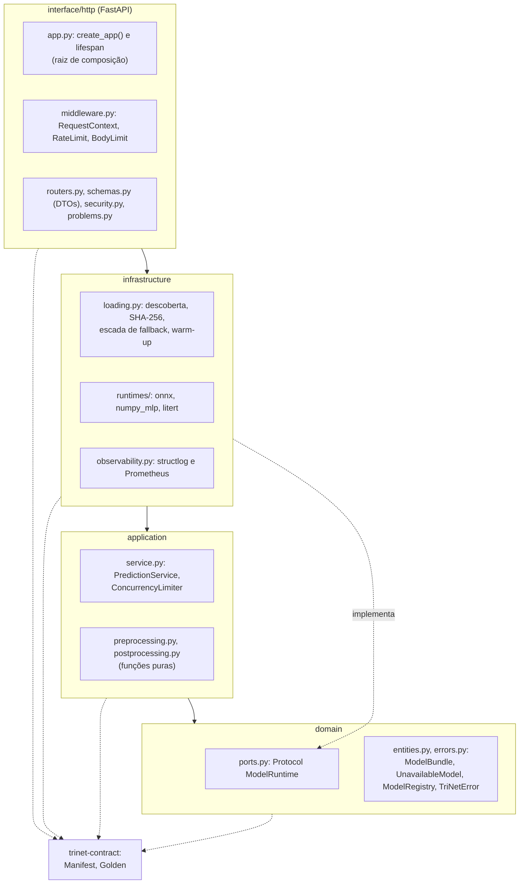
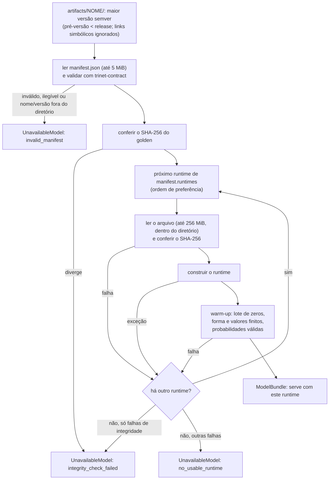
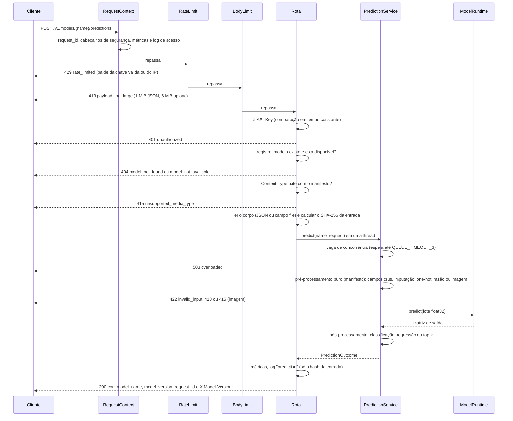

# Arquitetura da API

A API (`api/src/trinet_api/`) é uma arquitetura hexagonal enxuta, com **uma porta** (`ModelRuntime`) e comportamento
dirigido pelo manifesto de cada modelo ([ADR 0002](adr/0002-hexagonal-enxuta-dirigida-pelo-manifesto.md)). Este
documento descreve as camadas, o carregamento dos modelos, o caminho de uma requisição, o mapeamento de erros e as
métricas. O uso e os exemplos estão no [README](../README.md); a operação, no [runbook](runbook.md).

> Os modelos servidos são `credit-default-mlp`, `volatility-mlp` e `candlestick-cnn`. O projeto é educacional: nada
> aqui é recomendação de investimento nem decisão de crédito real.

## Camadas

| Camada | Responsabilidade | Pode importar |
|---|---|---|
| `domain` | a porta `ModelRuntime` (`kind`, `predict`), entidades imutáveis e a hierarquia de erros | só biblioteca padrão, NumPy e o contrato |
| `application` | `PredictionService` (um caso de uso, escolhe pré e pós-processamento pelo `manifest.input` e `manifest.output`), funções puras de pré e pós-processamento, limitador de concorrência | `domain` e o contrato; **não** FastAPI/Starlette, ONNX Runtime, `structlog` nem `prometheus_client` |
| `infrastructure` | carregador de artefatos, adaptadores de runtime, observabilidade | `application`, `domain`, ONNX Runtime, structlog, `prometheus_client` |
| `interface/http` | composição, rotas, DTOs, autenticação, Problem Details, middlewares ASGI | todas as camadas, **exceto** os adaptadores de runtime (só o carregador os instancia) |

As fronteiras são verificadas no CI por 6 contratos do import-linter (`make imports`). O contrato (`trinet-contract`)
não conhece a API.

### Os adaptadores de runtime

| Adaptador | Quando | Observação |
|---|---|---|
| `OnnxRuntime` | padrão (primeiro da escada) | ONNX Runtime; recusa ONNX com dados externos varrendo o protobuf, sem importar o pacote `onnx` |
| `NumpyMlpRuntime` | reserva para MLPs | camadas `normalize`, `dense` (relu, linear, softmax), `denormalize` e `exp`, a partir de um `.npz` lido com `allow_pickle=False` |
| `LiteRtRuntime` | reserva para a CNN | extra opcional `trinet-api[litert]`, importado sob demanda |

Todo adaptador passa pela mesma suíte (`api/tests/contract/`): float32, forma `(n, ...)`, saída finita, entrada não
mutada e chamadas concorrentes seguras. A camada `exp` do runtime NumPy existe para o `volatility-mlp`, cujo alvo de
treino é `ln(y)` ([ADR 0010](adr/0010-pivo-para-o-mercado-financeiro.md)).

## Carregamento dos modelos

O carregamento acontece no `lifespan`, em uma thread, **antes** de o servidor abrir o socket. Por isso `/health/live`
só responde depois que todos os modelos foram carregados ou marcados como indisponíveis. Um modelo que falha nunca
derruba a API.

- Só a **maior versão** de cada modelo é considerada. Se ela não carregar, o modelo fica indisponível: não há
  fallback silencioso para uma versão antiga.
- `ModelRegistry.ready` é verdadeiro quando ao menos um modelo serve. `/health/ready` devolve 200 `ok` (todos
  servem), 200 `degraded` (alguns) ou 503 `not_ready` (nenhum).
- O que cada `reason` significa e como agir está no [runbook](runbook.md#404-model_not_available).

## Fluxo de uma requisição de predição

Pontos que não são óbvios:

- A ordem dos middlewares, de fora para dentro, é `RequestContext` > `RateLimit` > `BodyLimit` > rotas. O limite de
  requisições vem **antes** da autenticação, e o limite de corpo vem antes de qualquer parse de JSON ou multipart
  ([ADR 0011](adr/0011-rate-limit-proprio-em-vez-de-slowapi.md)).
- O `RequestContext` também transforma qualquer exceção não tratada em um 500 `internal_error` genérico, que ainda
  leva o `X-Request-ID` e os cabeçalhos de segurança. O traceback vai só para o log.
- O modelo é resolvido **antes** de o corpo ser lido, então um nome errado custa um 404 sem ler megabytes.
- A inferência roda em uma thread (`run_in_threadpool`), limitada por `TRINET_MAX_CONCURRENCY`; `queue_timeout_s`
  decide quando a espera vira 503. O ONNX Runtime usa `TRINET_ORT_INTRA_OP_THREADS` threads.
- Pré-processamento tabular: só campos conhecidos, números finitos dentro de `minimum`/`maximum`, categóricos dentro
  do vocabulário, imputação por constante para `null`, one-hot, razão com divisor diferente de zero e matriz float32 na
  ordem de `features`. Imagem: magic bytes (o tipo declarado é ignorado), pixels pelo cabeçalho antes de decodificar,
  conversão para RGB e resize bilinear com Pillow.
- Pós-processamento: classificação devolve `label`, `probability` e `probabilities` (e `top_k` nas imagens);
  regressão devolve `value`, `unit` e `target`.

## Mapeamento de erros

Toda resposta de erro é `application/problem+json` (RFC 9457), com `type: urn:trinet:problem:<code>`, `code`
estável, `request_id` e, nos 422, a lista `errors` (`loc`, `code`, `message`). Nenhum stack trace, mensagem de exceção
inesperada ou valor da requisição é devolvido.

| HTTP | `code` | Origem | Cabeçalhos |
|---|---|---|---|
| 401 | `unauthorized` | `require_api_key` | `WWW-Authenticate: ApiKey` |
| 404 | `model_not_found` | `ModelNotFound` | |
| 404 | `model_not_available` | `ModelNotAvailable` | |
| 404 / 405 | `not_found` / `method_not_allowed` | Starlette | `Allow` (405) |
| 413 | `payload_too_large` | `BodyLimitMiddleware` ou `PayloadTooLarge` (imagem acima do `max_bytes`) | |
| 415 | `unsupported_media_type` | `UnsupportedInput` | |
| 422 | `invalid_input` | `InvalidInput` (JSON inválido, lote vazio ou grande, campos, faixas, vocabulário, divisor zero, arquivo ausente) | |
| 422 | `validation_error` | `RequestValidationError` do FastAPI | |
| 429 | `rate_limited` | `RateLimitMiddleware` | `Retry-After` |
| 500 | `inference_failed` | `InferenceFailed` (o runtime falhou ou a saída não bate com o lote) | |
| 500 | `internal_error` | `RequestContextMiddleware` (exceção inesperada) | |
| 503 | `overloaded` | `Overloaded` (sem vaga de inferência) | `Retry-After` |
| 503 | `not_ready` | `NotReady` (`/health/ready`, nenhum modelo serve) | |

Os demais erros do Starlette viram `http_<status>`.

## Observabilidade

- **Logs:** JSON por linha (`structlog`), com `request_id` ligado por requisição. Eventos: `http_request`,
  `prediction`, `rate_limited`, `unhandled_error`. A entrada nunca é registrada, só o `input_sha256`.
- **Métricas:** servidor `prometheus_client` em outra porta (`TRINET_METRICS_PORT`, 9100, não publicada), com registrador
  próprio: `trinet_http_requests_total`, `trinet_http_request_duration_seconds`, `trinet_inference_duration_seconds`,
  `trinet_predicted_class_total`, `trinet_http_inflight_requests`, `trinet_inflight_inferences`,
  `trinet_model_info` e as métricas de processo. Nenhum rótulo vem de dado da requisição: `model` só assume nomes de
  modelos carregados (qualquer outro vira `unknown`) e `route` é o *template* da rota.
- **Drift:** só o de predição, por PSI sobre `trinet_predicted_class_total`, para os classificadores; o
  `volatility-mlp` e a entrada não são cobertos ([ADR 0007](adr/0007-monitoramento-de-drift-psi.md)). Não há OpenTelemetry.

## Contrato com o notebook

O notebook (produtor) e a API (consumidora) só se encontram em `artifacts/<modelo>/<versão>/` e em `trinet-contract`
([ADR 0003](adr/0003-contrato-de-artefato.md)): `manifest.json` descreve campos, features, saída, runtimes com SHA-256,
métricas, quality gate, *serving skew* e proveniência; `golden.json` guarda entradas cruas e saídas esperadas. A
suíte `api/tests/golden/` prova que a API reproduz o treino a partir dessas entradas. O que o contrato **não** cobre
é o cálculo das features de série temporal e a renderização do gráfico, que são do chamador.
